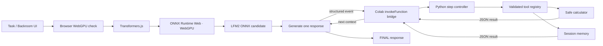

# WebGPU Backroom · LFM2 AI Entity

A Colab CPU-runtime control room with browser-local model inference. The notebook presents a dark “Backroom” console for an AI entity: Transformers.js + ONNX Runtime Web runs the model on the user's GPU through WebGPU; Colab Python validates tool calls and provides safe tools and session memory.

## Launch

1. Open [`webgpu_ai_loop.ipynb`](webgpu_ai_loop.ipynb) in Google Colab (or upload it).
2. Select a CPU runtime; no CUDA setup is required.
3. Run cells 1–7 in order.
4. In the console click **Load model**. This is explicit; opening the notebook does not download model weights.
5. Enter a task and click **Run Loop**.
6. Use **Diagnostics** for browser/provider/callback checks.

Use a current desktop Chrome or Edge with hardware acceleration. The UI does not switch to WASM/CPU if WebGPU fails. The bridge uses Colab's `google.colab.kernel.invokeFunction` and registered `output.register_callback` callbacks; it only works in Colab's notebook frontend.

## Architecture



The browser must generate because the weights and inference are local to the browser GPU. The controller callback in Python enforces step order/limits and owns tool execution. Conversation is browser run state; memory is Python runtime state.

## Models and compatibility

The notebook defaults to the requested 8B-A1B ONNX model and offers a 1.2B candidate. Candidate Hub IDs are `onnx-community/LFM2-8B-A1B-ONNX` and `onnx-community/LFM2-1.2B-ONNX`. The originally suggested `LiquidAI/LFM2-8B-A1B-ONNX` and `LiquidAI/LFM2-1.2B-ONNX` IDs are not used as assumed aliases. ONNX format alone does not guarantee Transformers.js compatibility: the repo must expose compatible config/tokenizer/graph/quantized artifacts and the pinned Transformers.js pipeline must recognize the architecture. Runtime load is therefore explicit and surfaced as a diagnostic, not claimed as browser-verified here. Test the 1.2B model first; 8B may exceed browser GPU memory.

Transformers.js version is pinned to 3.7.6. ORT Web is supplied through the pinned Transformers.js package; loading a separate ORT runtime can create duplicate/incompatible WASM/WebGPU backends. Runtime explicitly requests `device: 'webgpu'` and does not fall back. `requirements.txt` contains only Python test/runtime dependencies.

## Security and memory

- Calculator parses a constrained expression AST and rejects arbitrary code, attributes, and imports.
- Model output is untrusted. Only recognized JSON tool calls can reach the small allowlist.
- Arbitrary Python execution is disabled; the optional interface refuses execution and is not described as a secure sandbox.
- No secrets or API keys are passed into browser JS.
- Memories persist only for the current Python runtime session. They are not permanent storage. Clearing requires `clear_memories(confirmed=True)`.

## Tests

Notebook cell 7 runs deterministic mock tests without loading a model. Repository tests can be run with:

```bash
python -m pip install -r requirements.txt
python -m pytest -q
```

These tests do not establish that a real browser/GPU can load a particular Hub model. Real WebGPU inference must be validated in a supported browser/device.

## Troubleshooting

- **No WebGPU / adapter:** current desktop Chrome/Edge, hardware acceleration, compatible GPU driver, and secure context are needed. Do not expect CPU fallback.
- **Model/config/tokenizer error:** confirm the candidate model repository artifacts and Transformers.js compatibility; try 1.2B and check Diagnostics.
- **GPU out-of-memory:** unload, close GPU-heavy tabs, reload the page/browser, or select 1.2B. WebGPU allocations can remain until refresh.
- **No callback bridge:** execute in Google Colab rather than a local notebook frontend, and run callback-registration cell 4.
- **Slow/large download:** model weights download only after clicking Load model; browser cache may help subsequent loads.
