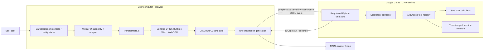

# Architecture: WebGPU Backroom and AI Entity

## Trust boundary and control flow

Browser inference is asynchronous and must remain in JavaScript. After each model response, the browser sends a JSON event through Colab's supported `google.colab.kernel.invokeFunction` bridge to a Python callback registered with `google.colab.output.register_callback`. Python validates session and step progression, recognizes final/tool/invalid outcomes, executes only allowlisted tools, and returns JSON. Browser appends the tool result to the next model context. Step count is bounded in both browser and Python.

The notebook does not pretend Python can synchronously pull local browser tokens. Nor does it expose Python runtime secrets to JavaScript. The browser uses explicit WebGPU only; unavailable WebGPU or unsupported model artifacts produce a visible error, never a hidden CPU fallback.

## AI entity and “Backroom” presentation

Backroom is the local development console, not an additional inference service. The entity persona/system prompt defines the LFM2 agent. UI reports GPU state, model loading/progress, step count, tool results, memory count, stop/error state. Model loading is user-triggered.

## Compatibility caveat

ONNX files do not guarantee Transformers.js compatibility. Model config, tokenizer, graph operators, quantization names, and library architecture support must align. Candidate ONNX Community LFM2 repositories are selected in the notebook; real load remains a runtime validation on target browser/device. The notebook has not been validated against actual WebGPU hardware in this build environment.
