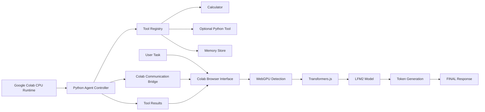

# WebGPU AI agent architecture

## Components

- Python Agent Controller: owns step limits, memory, and tool execution.
- Tool Registry: validates and routes calls to safe Python routines.
- Colab Communication Bridge: uses `google.colab.kernel.invokeFunction` to move data between browser and Python.
- Browser Inference Layer: loads the model locally with WebGPU and runs generation in the browser.
- Memory Store: session-only persistence; separate from conversation history.

## Trust boundaries

- Browser output is untrusted.
- Tool calls are structured JSON and must be validated.
- Python execution remains disabled unless explicitly enabled.

## Execution model

The browser does the heavy inference work while the Python runtime remains lightweight and orchestrative. This preserves Colab compatibility while keeping the model local to the user’s browser.
