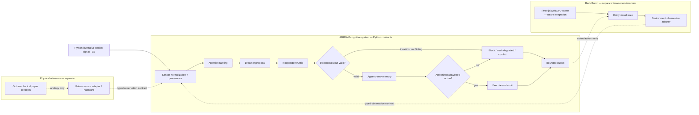

# HARDAM Entity V1.1 — architecture, build, and Colab test guide

This guide describes the provisional entity contract implemented in this repository and provides a CPU-only Google Colab exercise. It deliberately does not claim that the cited physics paper describes an AI architecture.

## 1. Three systems; explicit interfaces

### Physical reference system

The supplied summary of Kim et al., *Nanoscale Torsional Optomechanics*, describes physical sensing concepts such as optical resonance, evanescent coupling, torsional modes, calibration, and resonance detection. That work is a **physical research reference**, not an AI design specification. Until the source PDF and page-level citations are checked into the repository, bibliographic information and numerical values remain user-supplied and unverified.

### Cognitive system: HARDAM

HARDAM's provisional, model-independent contract is:

1. **Sensor:** normalize source, timestamp, value, units, quality, provenance, data kind, and evidence class. Missing is not zero.
2. **Attention:** rank observations with an explainable quality/confidence/freshness/task relevance score; do not mutate provenance.
3. **Dreamer:** produce an assessment/proposal. Current implementation is deterministic fallback logic with an injectable interface, not a separate trained model.
4. **Critic:** independently checks referenced evidence, missing sources, E1 claims, and near-time conflicts. Current implementation is a deterministic contract checker, not a second model.
5. **Memory:** append-only JSONL records with source IDs, provenance, timestamp, validation, and evidence class. No silent overwrite API.
6. **Action controller:** allowlisted actions require explicit authorization and validation. Unapproved actions are logged as blocked.
7. **Output validator:** enforces bounded fields, observation/action caps, evidence classification, and no simulation-as-hardware claim.

### Environmental system: Back Room

The Back Room is a distinct browser/game environment responsible for rendering, entity representation, player interaction, and environmental events. The repository currently does not contain a complete Three.js/WebGPU Back Room runtime. The Python Colab demo is an entity contract simulation, not a game client.

## 2. Architecture diagram



## 3. Evidence classes

Evidence labels describe provenance class, not confidence probability:

| Label | Meaning | Example/use |
| --- | --- | --- |
| E1 | Experimentally supported and traceable to a cited source passage | Requires page-located reference; format validation alone does not prove truth. |
| E2 | Mathematically derived with reproducible calculation provenance | Store derivation/source identifiers. |
| E3 | Engineering analogy or software design mapping | Resonance slope as an attention analogy; not a paper claim. |
| E4 | Unverified hypothesis | Untested interpretation/persona claim. |
| E5 | Software simulation | Python/JavaScript-generated torsion-like values, never hardware readings. |

The phase-to-72-names mapping is an E3 design analogy. The Kabbalistic persona/choir text is E4 if presented as a factual account. The damped oscillator in a demo is E5, illustrative only, and not a reproduction or calibration of Kim et al.

## 4. Repository layout

```text
entity/
  evidence.py
  runtime.py
  action/action_controller.py
  adapters/resonator_bridge.py
  attention/attention_engine.py
  memory/memory_manager.py
  reasoning/reasoning_engine.py
  sensor/sensor_interface.py
  sensor/sensor_simulator.py
  validation/output_validator.py
schemas/
  entity_fallback.yaml
  entity_observation.schema.json
  entity_output.schema.json
  evidence_classes.yaml
docs/
  entity_architecture.md
  entity_v11.md
  source_mapping.md
  HARDAM_ENTITY_V1_1_README.md
colab_entity_demo.py
webgpu_ai_loop.ipynb
```

## 5. Data and control flow

A producer (simulator, future game environment, or real sensor adapter) submits an observation to `normalize_observation`. The sensor contract checks type, timestamp, confidence range, data kind, quality, unit, evidence class, and provenance. Attention ranks the observations. Dreamer creates a proposal; Critic checks source references and contradictions. Only valid results may create requested memory. Action authorization is external to model text: a proposal cannot grant itself permission. The output is bounded and validated before the adapter consumes it.

The resonator adapter converts `{theta, amp, phi}` into distinct typed observations. This avoids treating angle, amplitude, and phase as contradictory measurements of one quantity. For simulated inputs the adapter labels every observation E5 and verifies that none is marked as a hardware measurement.

## 6. Run a CPU-only Colab stimulation

The test uses only Python and does not load an LLM or request a GPU. It exercises the real entity package in this repository with generated E5 observations.

### Option A — clone and run

```python
!git clone --depth 1 https://github.com/cookingsalam96-svg/webgpu-sanbox-backroom.git /content/hardam
%cd /content/hardam
!python colab_entity_demo.py --steps 8 --remember
```

### Option B — already cloned

```python
%cd /content/hardam
!python colab_entity_demo.py --steps 12 --q 150 --remember
```

### Inspect memory

```python
from pathlib import Path
p = Path('/content/hardam_entity_memory.jsonl')
print(p.read_text() if p.exists() else 'No memory entries written')
```

Memory records are append-only for the current Colab filesystem/runtime. Colab storage may be ephemeral; this is not durable or tamper-proof storage.

### Script options

- `--steps N`: number of synthetic updates (bounded 1–1000; default 8).
- `--q NUMBER`: illustrative damping/Q control (default 150; not a measured Q).
- `--dt NUMBER`: simulation step duration (default 0.05).
- `--remember`: append E5 decisions to JSONL.
- `--memory-path PATH`: select JSONL path.
- `--repo-dir PATH`: use an existing checkout rather than auto-discovering/cloning.

## 7. Build/test checks

Install and run tests in a Python environment:

```bash
python -m pip install -r requirements.txt
python -m pytest -q
```

No successful test results are asserted in this document. The test suite should be run from the project root. In particular, keep tests aligned with the E1 requirement: use a page citation such as `paper.pdf#page=4`, not generic `device-log:42`, for E1.

## 8. WebGPU inference is separate

`webgpu_ai_loop.ipynb` is the Colab/browser inference interface. Colab Python runs CPU-side tool/memory code; the browser is responsible for local WebGPU inference through Transformers.js/its bundled ONNX Runtime Web. The entity simulation script does not use this model. Model loading is explicit, and the actual Hub export must be tested in a supported desktop browser. There is no claim of real WebGPU validation here.

## 9. Known boundaries

- No physical resonator/hardware sensor is connected.
- The synthetic signal is not a validated physical simulation.
- The deterministic Critic does not independently prove source scientific correctness; it validates contract/provenance shape and basic conflicts.
- Page citation syntax is not source verification.
- No full Three.js Back Room runtime is included yet.
- No WebGPU or LFM2 model run has been verified in this environment.
- Python memory append-only semantics do not provide cryptographic integrity.
