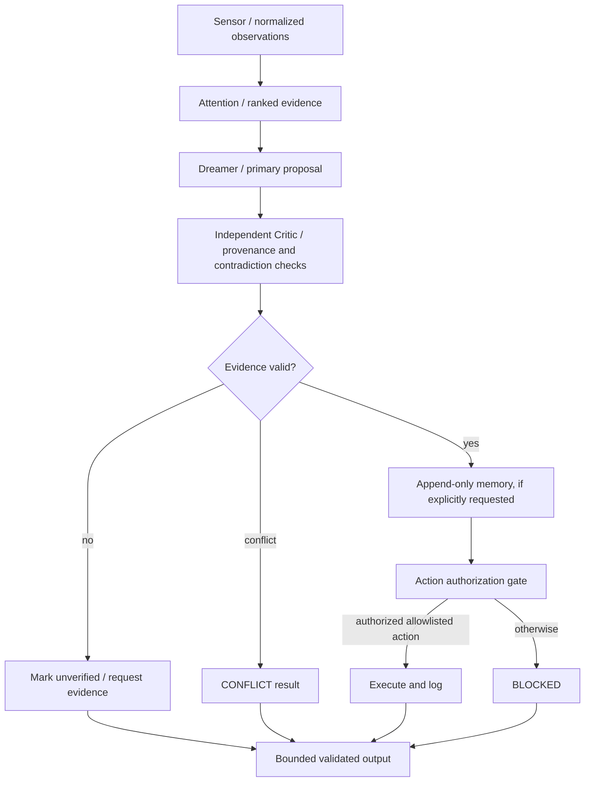

# HARDAM fallback entity architecture

## Scope and evidence boundary

This is an explicit software design fallback. The user-provided summary identifies the source as Kim et al., *Nanoscale Torsional Optomechanics*, arXiv:1210.1852v2. The actual PDF/source pages are not checked into this repository, so bibliographic details and numerical values are recorded as **user-supplied, not independently verified** in `schemas/entity_fallback.yaml`. The paper concerns physical optomechanical transduction, not an AI brain. Its concepts below are engineering analogies only.

## Architecture

The Dreamer and Critic are role-separated interfaces; this repository does not claim two separate trained models or independent hardware. Both are currently represented by deterministic Python contracts and injectable functions. Neither role can modify the other's memory or bypass the authorization gate.

## Layer contracts

- **Sensor:** preserves source, timestamp, confidence, units, quality, provenance, and data kind. Missing data is distinct from a measured zero. Simulation cannot be labeled hardware.
- **Attention:** ranks only supplied observations and includes reasons. It does not invent or upgrade evidence.
- **Dreamer:** proposes an assessment with evidence references, uncertainty, and candidate actions.
- **Critic:** verifies evidence identifiers, rejects unsupported claims, and detects contradictory values for the same observation type.
- **Memory:** append-only runtime JSON records; no silent updates. It is not durable storage unless an external persistence layer is explicitly added.
- **Action:** fail-closed allowlist and explicit authorization. Disallowed actions are logged as blocked, never executed.
- **Output:** schema-aligned shape, bounded list/text sizes, confidence, uncertainty, and validation flags.

## Optomechanics mapping (analogy, not equivalence)

| Physical paper concept in user-supplied summary | Software analogy | Important limit |
| --- | --- | --- |
| Whispering-gallery resonator / optical coupling | Sensor adapter | No optical hardware is included here. |
| AC/DC photodiode channels | Separate observation channels | Software values must retain their original units. |
| Resonance slope / signal quality | Attention scoring | Physical slope is not an AI attention mechanism. |
| Mechanical modes / FEM analysis | State and model-based reasoning | FEM is not an AI reasoner. |
| Thermomechanical calibration | Confidence and uncertainty discipline | Calibration values cannot be copied as AI confidence. |
| Experimental measurements | Provenance-bearing memory | User-supplied reference values are not HARDAM measurements. |

## Runtime and integration

The contracts are inference-engine independent. Browser WebGPU LFM2, another local model, or a deterministic test adapter can supply a proposal to the same validation boundary. The current Colab/browser notebook and this entity package are complementary: browser performs inference; Python validates outputs, memory writes, and allowlisted actions. No notebook runtime or actual WebGPU hardware is claimed tested by the entity unit tests.
